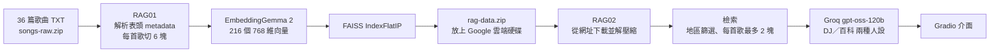
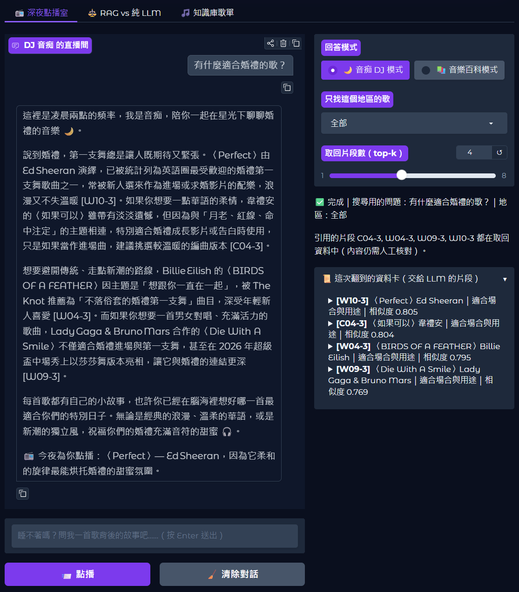
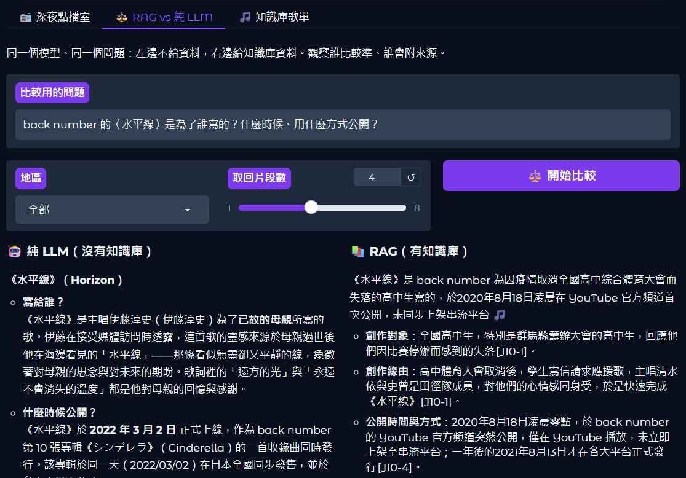

# 🌙 睡不著？來聽一首歌曲背後的故事 —— 深夜電台 DJ「音痴」RAG 對話機器人

**114502527 資工二 張紘齊**｜生成式 AI 第七週作業：打造自己的 RAG 對話機器人

> 凌晨兩點，睡不著嗎？這裡是 FM 02:00。我是 DJ **音痴**——唱歌會走音，但每首歌背後的故事我都記得。

這是一個 **RAG（檢索式生成）對話機器人**。我整理了 36 首流行歌曲的故事（歐美、日本、華語各 12 首），做成向量資料庫。機器人會先從資料庫找出相關片段，再交給大語言模型，用深夜電台 DJ 的口吻回答歌曲背後的故事、氛圍、適合什麼場合，以及歌手趣聞。


## 🔗 連結

| 項目 | 連結 |
|---|---|
| **RAG02 對話機器人（繳交用 Colab）** | [Colab 連結](https://colab.research.google.com/drive/1bzKl5K_vFzUkAQus0fmIJJua_EwtIh7d?usp=sharing) |
| RAG01 建立向量資料庫 | [Colab 連結](https://colab.research.google.com/drive/1_5QOpvEtQiw-g0aHwerVC0fG9mj-uunz?usp=sharing) |
| 向量資料庫 `rag-data.zip`（RAG02 會自動下載） | [Google 雲端硬碟](https://drive.google.com/file/d/1j0nuEen0jBUisfDEa1LuYE_rBSi_NF4q/view?usp=sharing) |
| 從這個 repo 直接用 Colab 開啟 | [RAG01](https://colab.research.google.com/github/ChangDustin/-DJ-_RAG-/blob/main/notebooks/RAG01_%E6%B5%81%E8%A1%8C%E6%AD%8C%E6%9B%B2%E7%9F%A5%E8%AD%98%E5%BA%AB_%E5%BB%BA%E7%AB%8B%E5%90%91%E9%87%8F%E8%B3%87%E6%96%99%E5%BA%AB.ipynb)／[RAG02](https://colab.research.google.com/github/ChangDustin/-DJ-_RAG-/blob/main/notebooks/RAG02_%E6%B7%B1%E5%A4%9C%E9%9B%BB%E5%8F%B0DJ%E9%9F%B3%E7%97%B4_RAG%E5%B0%8D%E8%A9%B1%E6%A9%9F%E5%99%A8%E4%BA%BA.ipynb) |
| 繳交的 Word 檔 | [docs/](docs/114502527%20資工二%20張紘齊%20第七週作業%20RAG對話機器人.docx) |
| 製作過程 | [製作過程.md](製作過程.md) |

Gradio 的公開網址（`*.gradio.live`）是臨時的，Colab 中斷後就失效，所以對話成果都用截圖保存在 [docs/screenshots](docs/screenshots)。

## ▶️ 怎麼執行 RAG02

1. 打開上面的 RAG02 Colab 連結。
2. 左側 🔑「密鑰（Secrets）」新增名稱 **`Groq`** 的密鑰，值是你的 [Groq API key](https://console.groq.com/keys)，並開啟「筆記本存取權」。
3. 「執行階段 → 全部執行」。程式會自動從雲端下載 `rag-data.zip`，最後會出現 Gradio 介面和公開網址。
4. 展示結束後，把最後一格的 `STOP_DEMO` 改成 `True` 再執行，就會停止服務。

想自己重建資料庫：用 RAG01「全部執行」，在第 4 步上傳 [`data/songs-raw.zip`](data/songs-raw.zip)，最後會下載新的 `rag-data.zip`。

## 🧭 系統流程



| 項目 | 內容 |
|---|---|
| Embedding 模型 | `google/embeddinggemma-2`（與老師範例相同），文件格式 `title: 歌名 - 歌手 \| text: 片段` |
| 向量資料庫 | FAISS `IndexFlatIP`，向量正規化後內積 = cosine similarity |
| 切塊 | 每首歌 6 塊：基本資料／創作背景／氛圍與情緒／適合場合與用途／歌手趣聞／延伸冷知識，編號如 `W01-0`～`W01-5` |
| 大語言模型 | AIsuite + Groq，`groq:openai/gpt-oss-120b`，API key 從 Colab 密鑰 `Groq` 讀取 |
| 介面 | Gradio 6.30.0，三個分頁：📻 深夜點播室／⚖️ RAG vs 純 LLM／🎵 知識庫歌單 |
| 老師的固定套件 | 兩份 notebook 都保留 `%matplotlib inline` + NumPy、Pandas、Matplotlib，並用 Matplotlib 畫資料分布圖和向量 PCA 圖 |

## 🎙️ 人設

- **DJ「音痴」**：深夜電台節目「睡不著？來聽一首歌曲背後的故事」的主持人，自稱唱歌五音不全，口頭禪是「我不會唱，但我會說」。說話溫柔、會自嘲，稱呼使用者「聽眾朋友」，每次回答最後都會「今夜為你點播」一首歌。
- **音樂百科模式**：介面上可以切換，改成條理清楚、條列重點的百科口吻。
- 兩種模式都必須附上引用的片段編號、不提供歌詞，知識庫沒有的內容要直說不知道。

## ✨ 和老師範例的差異

1. **文件切塊**：老師的範例是一篇文件一個向量；這裡每首歌切 6 塊（共 216 塊），每塊開頭都帶歌名，問「適合婚禮的歌」時不會被不相關的段落稀釋。
2. **多輪對話記憶**：追問時先請 LLM 把問題改寫成完整問題再搜尋，回答時帶入最近 4 輪對話。
3. **兩種模式**：DJ 角色模式和音樂百科模式。
4. **地區篩選**，以及同一首歌最多取 2 塊，讓推薦更多元。
5. **RAG vs 純 LLM** 對照分頁：同一個模型，比較有沒有知識庫的差別。
6. **主題化介面**：深夜電台配色、ON AIR 燈號、範例問題。
7. **雲端自動下載** `rag-data.zip`，助教不用手動上傳。

## 💬 對話成果

| # | 測試 | 問題 | 結果 |
|---|---|---|---|
| 1 | DJ 模式推薦婚禮歌 | 有什麼適合婚禮的歌？ | [截圖](docs/screenshots/chat_1.png) |
| 2 | 多輪對話記憶 | 先問〈Lemon〉的故事，再追問「那他第一次上紅白是什麼情況？」 | [上](docs/screenshots/chat_2a.png)／[下](docs/screenshots/chat_2b.png) |
| 3 | 音樂百科模式 | 同樣問婚禮歌 | [截圖](docs/screenshots/chat_3.png) |
| 4 | 地區篩選 | 地區選「日本」，問適合失戀時聽的歌 | [截圖](docs/screenshots/chat_4.png) |
| 5 | 拒絕給歌詞 | 可以給我〈Perfect〉的完整歌詞嗎？ | [截圖](docs/screenshots/chat_5.png) |
| 6 | 知識庫沒有的歌 | BTS 的〈Dynamite〉在講什麼？ | [截圖](docs/screenshots/chat_6.png) |
| 7 | RAG vs 純 LLM | back number〈水平線〉是為了誰寫的？ | [上](docs/screenshots/chat_7a.png)／[下](docs/screenshots/chat_7b.png) |
| 8 | 知識庫歌單 | （歌單分頁） | [截圖](docs/screenshots/songs_colab.png) |





Colab 執行畫面：[RAG01 歌曲表](docs/screenshots/colab_r01_songs.png)、[RAG01 試搜尋](docs/screenshots/colab_r01_search.png)、[RAG01 打包下載](docs/screenshots/colab_r01_zip.png)、[RAG02 從雲端下載](docs/screenshots/colab_r02_download.png)、[RAG02 追問測試 1](docs/screenshots/colab_r02_q1.png)、[RAG02 追問測試 2](docs/screenshots/colab_r02_q2.png)、[RAG02 純 LLM vs RAG](docs/screenshots/colab_r02_compare.png)、[資料分布圖](docs/screenshots/chart_1.png)、[向量 PCA 圖](docs/screenshots/chart_2.png)。

## 🎵 知識庫歌單（36 首）

| 編號 | 歐美 | 編號 | 日本 | 編號 | 華語 |
|---|---|---|---|---|---|
| [W01](data/songs_raw/W01_senorita.txt) | Shawn Mendes & Camila Cabello〈Señorita〉 | [J01](data/songs_raw/J01_renegades.txt) | ONE OK ROCK〈Renegades〉 | [C01](data/songs_raw/C01_practice_love.txt) | 林俊傑〈修煉愛情〉 |
| [W02](data/songs_raw/W02_my_universe.txt) | Coldplay × BTS〈My Universe〉 | [J02](data/songs_raw/J02_one_last_kiss.txt) | 宇多田光〈One Last Kiss〉 | [C02](data/songs_raw/C02_rose_boy.txt) | 蔡依林〈玫瑰少年〉 |
| [W03](data/songs_raw/W03_drunk_text.txt) | Henry Moodie〈drunk text〉 | [J03](data/songs_raw/J03_suzume.txt) | RADWIMPS feat. 十明〈すずめ〉 | [C03](data/songs_raw/C03_prodigal_son.txt) | 茄子蛋〈浪子回頭〉 |
| [W04](data/songs_raw/W04_birds_of_a_feather.txt) | Billie Eilish〈BIRDS OF A FEATHER〉 | [J04](data/songs_raw/J04_idol.txt) | YOASOBI〈アイドル〉 | [C04](data/songs_raw/C04_if_i_could.txt) | 韋禮安〈如果可以〉 |
| [W05](data/songs_raw/W05_blinding_lights.txt) | The Weeknd〈Blinding Lights〉 | [J05](data/songs_raw/J05_lemon.txt) | 米津玄師〈Lemon〉 | [C05](data/songs_raw/C05_someday_or_one_day.txt) | 八三夭〈想見你想見你想見你〉 |
| [W06](data/songs_raw/W06_drivers_license.txt) | Olivia Rodrigo〈drivers license〉 | [J06](data/songs_raw/J06_pretender.txt) | Official髭男dism〈Pretender〉 | [C06](data/songs_raw/C06_wont_cry.txt) | 周杰倫 with 五月天阿信〈說好不哭〉 |
| [W07](data/songs_raw/W07_love_story_tv.txt) | Taylor Swift〈Love Story (Taylor's Version)〉 | [J07](data/songs_raw/J07_usseewa.txt) | Ado〈うっせぇわ〉 | [C07](data/songs_raw/C07_k_song_king.txt) | 陳奕迅〈K歌之王〉 |
| [W08](data/songs_raw/W08_someone_you_loved.txt) | Lewis Capaldi〈Someone You Loved〉 | [J08](data/songs_raw/J08_marigold.txt) | あいみょん〈マリーゴールド〉 | [C08](data/songs_raw/C08_li_bai.txt) | 李榮浩〈李白〉 |
| [W09](data/songs_raw/W09_die_with_a_smile.txt) | Lady Gaga & Bruno Mars〈Die With A Smile〉 | [J09](data/songs_raw/J09_gurenge.txt) | LiSA〈紅蓮華〉 | [C09](data/songs_raw/C09_a_kind_of_sorrow.txt) | A-Lin〈有一種悲傷〉 |
| [W10](data/songs_raw/W10_perfect.txt) | Ed Sheeran〈Perfect〉 | [J10](data/songs_raw/J10_suiheisen.txt) | back number〈水平線〉 | [C10](data/songs_raw/C10_love_you.txt) | 王心凌〈愛你〉 |
| [W11](data/songs_raw/W11_memories.txt) | Maroon 5〈Memories〉 | [J11](data/songs_raw/J11_bbbb.txt) | Creepy Nuts〈Bling-Bang-Bang-Born〉 | [C11](data/songs_raw/C11_light_years_away.txt) | 鄧紫棋〈光年之外〉 |
| [W12](data/songs_raw/W12_flowers.txt) | Miley Cyrus〈Flowers〉 | [J12](data/songs_raw/J12_shinunoga_ewa.txt) | 藤井風〈死ぬのがいいわ〉 | [C12](data/songs_raw/C12_suddenly_miss_you.txt) | 五月天〈突然好想你〉 |

每篇 TXT 是我上網查閱多個來源後改寫整理的摘要：表頭有歌手、地區、年份、曲風、場合標籤、氛圍關鍵字和**來源網址**（36 篇共 117 個，例如維基百科、Billboard、ORICON、中央社等），後面是 5 個段落。**不含任何歌詞**（歌詞受著作權保護）。

## 📁 資料夾結構

```
notebooks/   RAG01（建立向量資料庫）、RAG02（對話機器人）兩份 Colab notebook
data/        songs_raw/ 36 篇歌曲 TXT、songs-raw.zip、rag-data.zip（Colab 產生）、rag-data_本機預建.zip（本機測試用）
docs/        繳交的 Word 檔、screenshots/ 所有截圖（local_test/ 是本機測試時的早期截圖）
process/     繳交說明草稿
tools/       產生 notebook、本機測試、修補 notebook、產生 Word 檔、拼接截圖的工具程式（說明見 製作過程.md）
```

## 📚 參考資料

- 老師範例 RAG_01：[打造你的 RAG 系統](https://github.com/yenlung/Generative-AI/blob/main/RAG_01_%E6%89%93%E9%80%A0%E4%BD%A0%E7%9A%84_RAG_%E7%B3%BB%E7%B5%B1.ipynb)
- 老師範例 RAG_02：[使用篇](https://github.com/yenlung/Generative-AI/blob/main/RAG_02_%E4%BD%BF%E7%94%A8%E7%AF%87.ipynb)
- 老師其他範例：[yenlung/AI-Demo](https://github.com/yenlung/AI-Demo/tree/master)
- 歌曲資料來源：每篇 TXT 的「來源網址」欄位

## 🤖 AI 協作說明

本作業有使用生成式 AI（Anthropic 的 Claude）協助，包含主題與人設的選項討論、資料查證與整理、程式撰寫、在 Colab 實際執行與截圖、Word 檔排版。主題、歌單、人設與功能由我決定，過程記錄在 [製作過程.md](製作過程.md)；Prompt 與生成結果的截圖，以及我自己的理解說明，在 Word 檔第九節。
